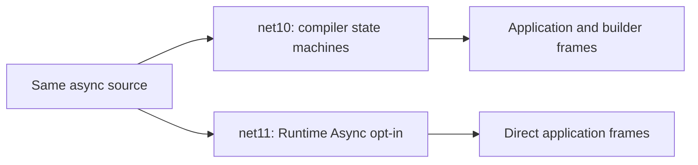

# 01 - Runtime Async

**Takeaway:** the compiler no longer needs to generate the traditional async
state-machine machinery for the opted-in .NET 11 application methods; the
runtime manages async execution instead.

## Before and after

Compare [`net10/Program.cs`](../net10/Program.cs) with
[`net11/Program.cs`](Program.cs): the source is intentionally identical.
Both load a meetup schedule through three async methods and capture a **live
stack** in the innermost method.

The difference is in the project files:

- [Before](../net10/RuntimeAsyncBefore.csproj): `net10.0`, C# 14,
  `UseRuntimeAsync=false` and `runtime-async=off` explicitly preserve traditional
  compiler lowering even when building with the pinned .NET 11 SDK.
- [After](RuntimeAsyncAfter.csproj): `net11.0`, C# 15,
  `<Features>$(Features);runtime-async=on</Features>` opts in.

`EnablePreviewFeatures` is not required for Runtime Async on this net11 RC2
project. The opt-in does not need to be applied to the other examples.

## Run

From the **repository root**, after building the solution:

```powershell
dotnet run --project .\01-runtime-async\net10 --configuration Debug --no-build --no-restore
dotnet run --project .\01-runtime-async\net11 --configuration Debug --no-build --no-restore
```

Both print `Live stack:` and finish with `Schedule loaded.`. Find
`ShowSpeakerAsync`, `LoadSessionAsync`, and `LoadScheduleAsync` in both stacks.
The before stack also contains `AsyncMethodBuilderCore.Start` infrastructure;
the after stack presents the application chain directly.



## Show it live

1. Open the two source files: no application rewrite.
2. Show the project-level opt-out and opt-in.
3. Run before, point to builder frames, then run after and follow the method chain.

## Limitations

The awaits deliberately use already-completed tasks to keep this entire call
chain on the live stack. This is a stack-shape demo of the synchronous fast path,
not a claim that all async calls remain on one physical stack after suspension.
`NoInlining` keeps the application methods visible; use Debug for the demo.
Exact frames depend on JIT/build/platform and must not be treated as a fixed
13-versus-5 contract.

Do not substitute `Exception.StackTrace`: exception traces already receive
cleanup in the traditional model. This example measures no allocation or
throughput improvement. Runtime Async is still a preview in this RC2 baseline.

Source: [Runtime Async and cleaner live stacks](https://learn.microsoft.com/en-us/dotnet/core/whats-new/dotnet-11/runtime#runtime-async).

[Back to the demo index](../../README.md)
