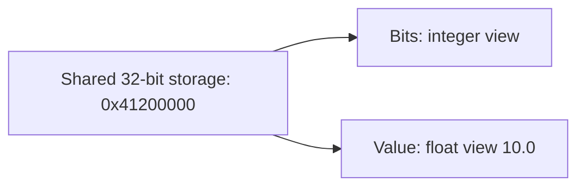

# 07 - Extended layout support

**Takeaway:** extended layout lets the compiler and runtime describe a C-style
union's storage intent directly, instead of spelling out every field offset.
This is a specialized interop feature, not the type-safe union from example 02.

## Before and after

Interpret a sensor's raw 32-bit reading as an IEEE 754 floating-point value.
Compare [`net10/Program.cs`](../net10/Program.cs) and
[`net11/Program.cs`](Program.cs).

Before, `[StructLayout(LayoutKind.Explicit)]` and `[FieldOffset(0)]` place the
integer and float at the same address. After,
`[ExtendedLayout(ExtendedLayoutKind.CUnion)]` expresses the union layout.
The compiler emits extended-layout metadata and the .NET 11 runtime interprets
it. The application no longer assigns each field an offset.

[Before project](../net10/ExtendedLayoutBefore.csproj) uses .NET 10 / C# 14;
[after project](ExtendedLayoutAfter.csproj) uses .NET 11 / C# 15. This minimal
case works on RC2 without additional preview flags, unsafe blocks, or a native
library.



## Run

From the **repository root**, after building the solution:

```powershell
dotnet run --project .\07-extended-layout-support\net10 --configuration Debug --no-build --no-restore
dotnet run --project .\07-extended-layout-support\net11 --configuration Debug --no-build --no-restore
```

Before:

```text
Raw bits: 0x41200000
Sensor value: 10.0
Layout: ExplicitLayout
```

After:

```text
Raw bits: 0x41200000
Sensor value: 10.0
Layout: ExtendedLayout
```

The float is formatted with invariant culture so the displayed decimal point
does not depend on the presenter's locale.

## Show it live

1. Show the two offset attributes in the before struct.
2. Replace the layout declaration with the CUnion attribute in the after struct.
3. Run both: the bit interpretation matches, but reflection exposes different
   layout metadata.

## Limitations

These fields overlay the same bytes; they are not independent stored values.
The struct tracks no active case and does not prevent reading the wrong view.
Only primitive unmanaged fields are used here; do not generalize the example to
overlapping managed references.

The example has been exercised on Windows x64. Real interop requires validating
size, alignment, packing, endianness, and the specific target ABI against native
declarations on every supported platform. The new attribute does not make
arbitrary structs binary-compatible.

Sources: [ExtendedLayoutAttribute](https://learn.microsoft.com/en-us/dotnet/api/system.runtime.interopservices.extendedlayoutattribute?view=net-11.0),
[Extended layout attribute reference](https://learn.microsoft.com/en-us/dotnet/csharp/language-reference/attributes/general#extendedlayout-attribute).

[Back to the demo index](../../README.md)
